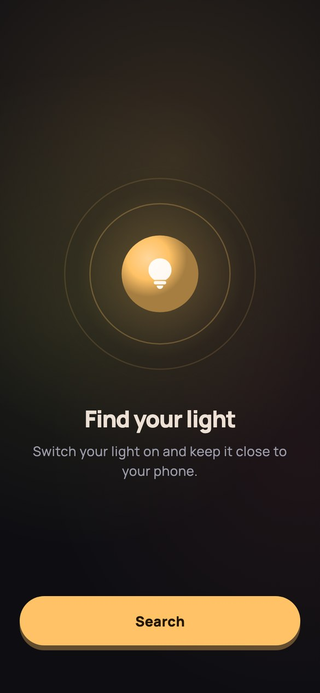
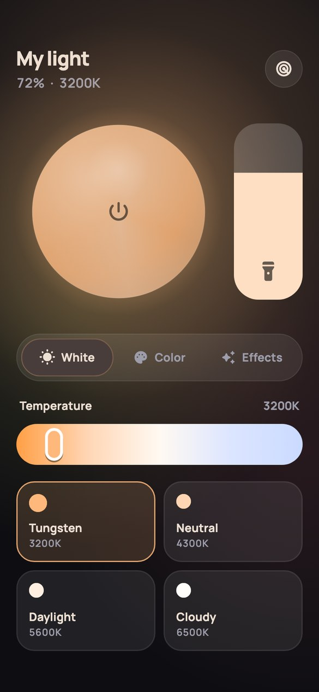
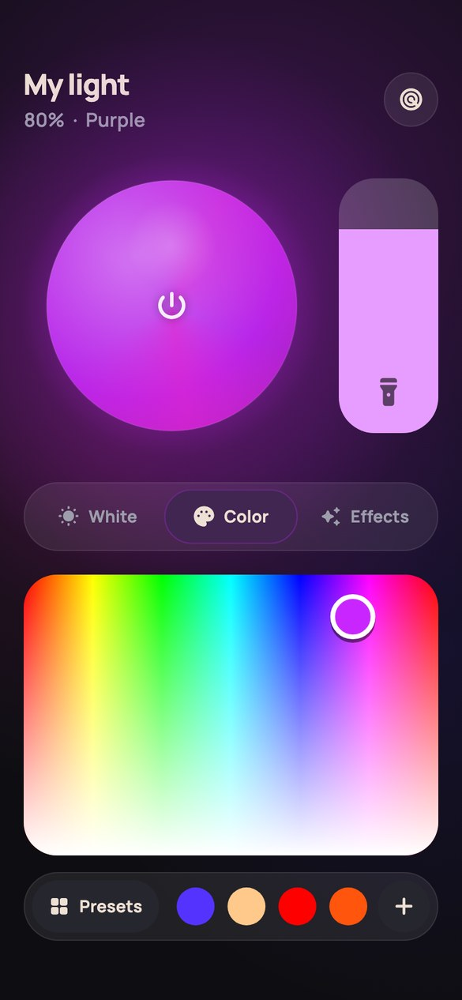
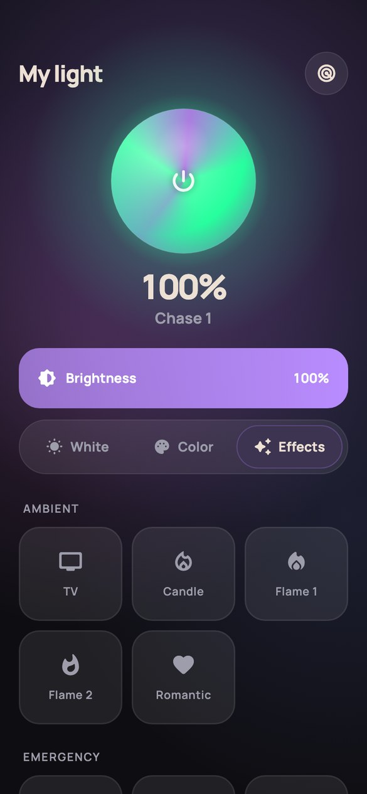
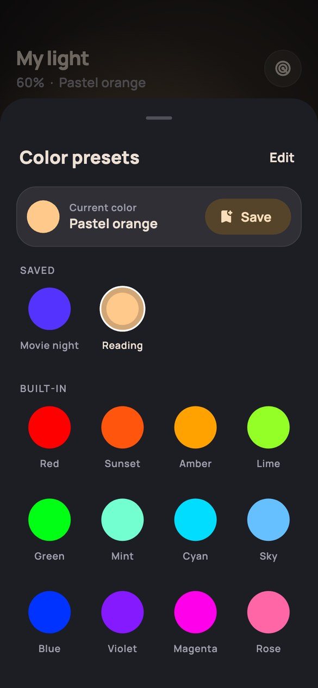

# lumen

a better remote for the bluetooth led lights that normally use the **ledlyd** app.

find your light in a few taps, then set white, color, brightness and effects from one screen. works on android and ios. no accounts, no internet.

<p align="center">
  
  
  
  
  
</p>

> not affiliated with ledlyd or whoever makes the lights. this is an independent project.

## why

i have one of these lights and wanted a much better ui and pairing that just works. so i reverse engineered the ledlyd app's bluetooth protocol and built this.

the interesting part was pairing. my light never showed up in a bluetooth scan, no matter what. turns out it doesn't advertise at all. it only listens for broadcast adverts on its channel (100 by default) and does whatever they say. so lumen doesn't really "connect" to it, it just broadcasts.

one bug worth mentioning: the stock app's code addresses "all groups" as 255 in one place. send that and white and most effects break, because it bleeds into the effect bits. the value that actually works is 7.

## what it does

- **finds your light without setup codes.** lumen makes the light blink and asks if you saw it. if the light was moved off its default channel, it checks every channel and group until you say it turned red.
- **white**: 2500 K to 9900 K, plus tungsten, neutral, daylight and cloudy presets.
- **color**: a color pad for hue and saturation, a quick presets row, and a presets sheet with 12 built-in colors. you can save your own colors by name and delete them.
- **effects**: all 24 effects the light has:
  - ambient: tv, candle, flame 1-2, romantic
  - emergency: police, ambulance, fire truck
  - flash & strobe: flash 1-2, strobe 1-3
  - party: chase 1-3, fireworks 1-3, club 1-2, music, wave 1-2
- **brightness and power**: big brightness slider. tap the light on screen to turn the real one on or off.
- **live preview**: the on-screen light glows in your color and plays a soft preview of the selected effect.
- **remembers stuff**: your light, its last setting and your saved colors stay on the phone. open the app and the light goes back to how you left it.

## which lights work

lumen uses the same bluetooth protocol as the ledlyd app (android package `uni.UNI6FB700B`). basically, if your light works with ledlyd, it should work with lumen.

those lights come in two kinds. lumen handles both:

| kind | how to tell | how lumen controls it | status |
|---|---|---|---|
| **broadcast lights** | never show up in a bluetooth scan. small handheld rgb lights with a screen and **M / + / − / ▶** buttons. | broadcasts settings on the light's channel (1-100) and group (a-f or all). default is channel 100, all groups. | tested on a real light. white, color, brightness, power and all effects work. |
| **connected lights** | show up in a scan as `LTF_MWRGB`, `LYD_MWRGB`, `Bough_Systems` or `LYDBough_Systems`. | connects and sends commands directly. the light reports its settings back. | built from the protocol, not tested on a real light yet. |

won't work with lights that use a different app, like philips hue, govee, nanoleaf, aputure sidus or godox.

## getting started

1. turn the light on and keep it close to your phone.
2. open lumen and allow bluetooth ("nearby devices" on android).
3. tap **search**. lumen makes your light blink.
   - blinking? tap **yes**. done.
   - not blinking? tap **no**. lumen checks every channel and group, which can take a few minutes. tap **it turned red** as soon as your light turns red. then it flashes the last few candidates red and blue until you confirm the right one.
4. connected lights show up under **found nearby** on the search screen. tap one to connect.

to set up a different light later, tap the radar button in the top right.

## good to know

- **broadcast lights can't send anything back.** so no battery level, and no reading the light's current setting. lumen just shows what it last sent.
- **lumen only controls the light while it's open.** it stops broadcasting in the background, and ios doesn't allow background broadcasting anyway.
- **one phone at a time.** if two phones broadcast different settings on the same channel, the light keeps flipping between them. close lumen or ledlyd on the other phone.
- **one light at a time.** lumen controls the light you set it up with. lights sharing a channel and group all follow it together.
- **reduce motion works.** looping animations stop when it's on, and effect previews never flash more than 3 times a second.

## privacy

no accounts, no analytics, no ads, no network requests. the android release build doesn't even ask for internet access. everything stays on your phone.

## requirements

- android 7.0 or newer, with bluetooth that supports advertising (almost every phone does)
- ios 15 or newer

## building

needs flutter 3.47+ (dart 3.13).

```sh
flutter pub get
flutter run                          # on a real phone, bluetooth doesn't work in simulators
flutter build apk --release
flutter build ios --release          # set your signing team in xcode first
```

generated code (`*.freezed.dart`, `*.g.dart`) is committed. if you change a model, provider or view model, regenerate it:

```sh
dart run build_runner watch -d
```

tests cover the wire codecs, preset storage and every view model, using fake repositories from `test/testing/`:

```sh
flutter test
```

## how it talks to the light

**broadcast lights** listen for a 23-byte iBeacon-shaped advert:

```
02 15 | uuid FAA50000-1111-ABCD-0123-BE89 + channel (u32) | major | minor | power
```

- major packs the group (bits 0-2, 7 = all groups), the effect and the saturation
- minor is the hue, or the color temperature
- power is the brightness, 0 means off

android sends it as manufacturer data with company id `0xFFFF` (`MainActivity.kt`). ios doesn't let apps send custom manufacturer data, so it goes out as a real iBeacon instead (`AppDelegate.swift`). the light follows both.

**connected lights** use gatt service `FFF0`. lumen writes 10-byte frames to `FFF3` (mode, effect, brightness, temperature, hue, saturation, effect params) and reads the same layout back from `FFF4`.

the encoders are in `lib/src/services/protocol/`.

## project structure

follows the [flutter app architecture guide](https://docs.flutter.dev/app-architecture/guide). mvvm in the ui layer, services and repositories in the data layer, riverpod for di and view model state.

```
lib/
  main.dart               startup: storage, provider container, runApp
  src/
    app.dart              lifecycle, MaterialApp
    core/
      providers.dart      dependency graph (services -> repositories)
      models/             pure models: LightState, PairedLight, Effect, ColorPreset, ...
      theme/              theme, motion, light colors, effect previews
      widgets/            shared widgets: light orb, color pad, sliders, ...
    services/             platform wrappers: ble (flutter_blue_plus), the native
                          broadcaster (method channel), SharedPreferences, hive
      protocol/           wire codecs (gatt frame, broadcast beacon)
    repositories/         sources of truth: BluetoothRepository, LightRepository,
                          PresetRepository
    modules/
      gate/               picks the top-level screen
      search/             finds the light by making it blink
      control/            white, color, effects and presets
        view_models/      riverpod notifiers: immutable state + intent methods
        widgets/          views: read state, call view model methods
```

dependencies only point down: views -> view models -> repositories -> services. views never touch repositories, view models never touch bluetooth apis.

built with:

- [freezed](https://pub.dev/packages/freezed) for immutable models and screen states
- [riverpod_generator](https://pub.dev/packages/riverpod_generator) for providers and view models
- [hive_ce](https://pub.dev/packages/hive_ce) for saved colors
- [flutter_animate](https://pub.dev/packages/flutter_animate) for entrance animations
- [flutter_blue_plus](https://pub.dev/packages/flutter_blue_plus) for scanning and connecting

## licenses

- **flutter_blue_plus** is free for non-commercial use only. shipping lumen commercially needs a commercial license from its authors, or a different ble library.
- **manrope** font is under the sil open font license (`assets/fonts/Manrope-OFL.txt`).
